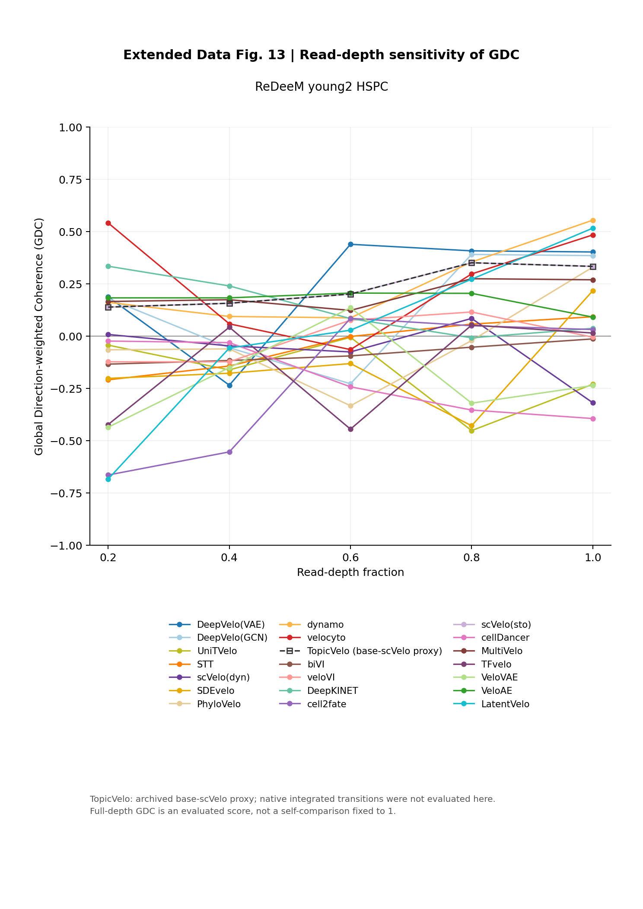

# Extended Data Fig. 13 — Read-depth sensitivity of GDC



The plot shows 21 methods at five read-depth fractions for ReDeeM young2 HSPC. All 105 GDC values are retained from saved evaluations. Colors and legend order match the current main Figure 6b, extracted and checked from its vector legend.

TopicVelo is explicitly labeled as the archived base-scVelo proxy; these are not its native integrated-transition results. No model or metric was rerun. ED13 is appended without renumbering existing figures; manuscript citation and full caption remain author-managed.

- [PDF](figures/Extended_Data_Fig13.pdf) · [SVG](figures/Extended_Data_Fig13.svg)
- [Source workbook](data/source_data/Extended_Data_Fig13_reads_GDC.xlsx)
- [Plotted values](data/read_depth_gdc_20261026/plotted_GDC.csv) · [Method colors](data/read_depth_gdc_20261026/method_palette.csv)
- [Independent plotting entry](code/a/ed13a.py) · [Code and interpretation notes](code/README.md)
- [Validation](../../12_Provenance/ed13_reads_gdc_validation.json)

```bash
python 08_Extended_Data/ExtendedDataFig13/code/a/ed13a.py --out /tmp/ed13
```
