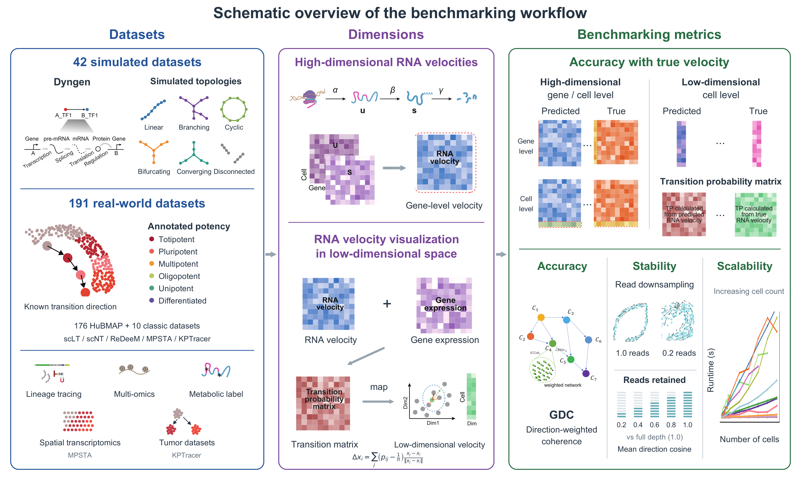

# RNA velocity benchmark

Code, saved results and figures for a multilevel benchmark of RNA velocity inference.
**Current release: Manuscript_1021, including updates through 22 October 2026; published 23 October 2026.**

This repository follows **Main Figures 1–7** and **Extended Data Figures 1–12**. Figures 1–2 are schematics and contain only figures. Figures 3–7 and the Extended Data folders include source tables and analysis inputs alongside the figures. Shared files are stored once. [Release notes](12_Provenance/RELEASE_1021.md) describe what changed from the previous public version.

## Main figures

| Figure | Topic | Materials |
|---|---|---|
| 1 | Timeline of RNA velocity methods | [Figures](01_Figure01/README.md) |
| 2 | Benchmarking framework | [Figures](02_Figure02/README.md) |
| 3 | Evaluation on simulated and conventional datasets | [Code, data and figures](03_Figure03/README.md) |
| 4 | ReDeeM | [Code, data and figures](04_Figure04/README.md) |
| 5 | Spatial and lineage-referenced evaluation | [Code, data and figures](05_Figure05/README.md) |
| 6 | Runtime, read-depth sensitivity, weighted composite and VeloGIF | [Code, data and figures](06_Figure06/README.md) |
| 7 | Age-related examples and future directions | [Code, data and figures](07_Figure07/README.md) |



## What changed

- **Spatial evaluation:** archived TopoVelo predictions are included in Figure 5 and Extended Data 9–10; undefined paired directions stay missing.
- **KPTracer:** the saved PhyloVelo field and its direction audit are included. The displayed field is backward; evaluation uses its negative. Adapted GDC +1 is diagnostic and has no comparable rank.
- **Noise series:** Extended Data 4c contains all 30 cellDancer scenario/noise conditions, with explicit missingness and coverage for cross-noise means.
- **Figure organization:** runtime and read-depth sensitivity move to Figure 6a/b; 6c uses provisional Accuracy/Scalability/Stability weights of 0.50/0.25/0.25; VeloGIF is in 6d. Current PDFs use submission numbering and A4 pages.

## Find materials

- [Extended Data Figures 1–12](08_Extended_Data/README.md)
- [One plot per file: panel code index](12_Provenance/PANEL_CODE_INDEX.md)
- [Core workflows and runnable validation](09_Core/README.md)
- [Shared data](10_Shared/README.md) · [Tables](11_Tables/README.md)
- [Current provenance and validation](12_Provenance/README.md) · [Historical materials](13_Archive/README.md)

## Check the saved results

```bash
python -m pip install -r requirements-demo.txt
python 09_Core/validation/verify_release.py
python 09_Core/validation/reproduce.py --out /tmp/rna-velocity-check --no-plots
python 09_Core/validation/validate_latest_results.py --out /tmp/rna-velocity-1021
python 09_Core/visualization/plot_saved_panels.py --out /tmp/rna-velocity-panels
```

For the independent PhyloVelo H5AD direction/CBDir audit, install `requirements-audit.txt` and run:

```bash
python 09_Core/validation/validate_phylovelo.py --out /tmp/rna-velocity-1021
```

These commands audit saved data and produce diagnostic plots. They do not refit models or reconstruct every formal layout. [Evidence limits and external inputs](12_Provenance/RELEASE_1021.md) distinguish saved-result checks, historical training provenance and unresolved age-example evidence. Missing values remain missing; the composite retains its historical endpoint inputs while the three component weights are updated.

Simulation datasets, annotated HuBMAP metadata and processed ReDeeM data are available on [Figshare](https://figshare.com/articles/dataset/28021724). Dataset details and input provenance are supplied with the figure records.

The full manuscript and editorial backups are excluded. No new blanket license is assigned; see [LICENSE_STATUS.txt](LICENSE_STATUS.txt). The previous public release remains available at [2524fdc](https://github.com/liyarubio/RNA-velocity-benchmark/tree/2524fdc0a4088c8c2a41a2362a368eba613944d6).
